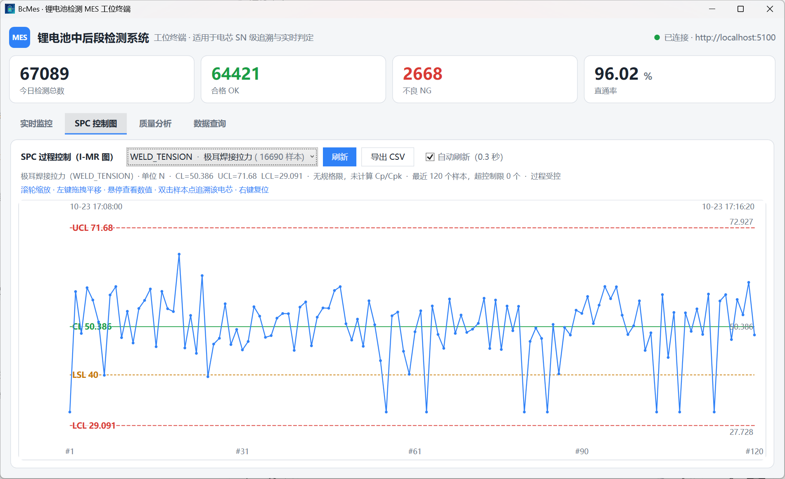
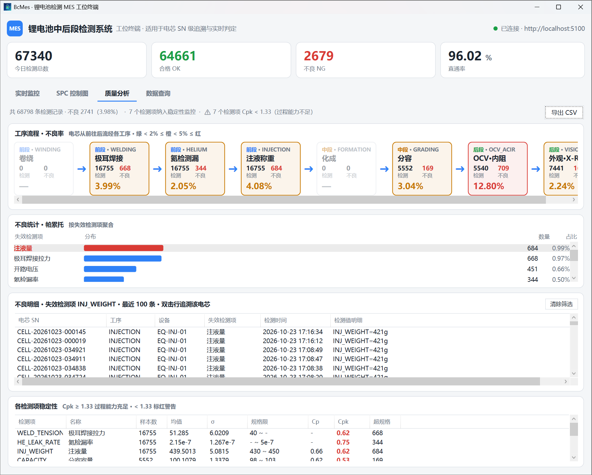

<div align="center">


# BcMes

**锂电池中后段检测 MES**

`WPF` · `ASP.NET Core` · `OPC UA` · `SQL Server` · `TDengine` · `Redis`

</div>

## 界面

**SPC 控制图**（实时看板 + I-MR 控制图 + Cp/Cpk）



**质量分析**（工序不良率流程 + 不良帕累托 + 不良明细下钻 + 稳定性总览）



> 四个页签：实时监控 / SPC 控制图 / 质量分析 / 数据查询（单芯追溯 + 多维筛选），0.3s 自动刷新，零图表库自绘。

## 架构

三个进程 + 三套中间件，按真实工厂架构搭建：

```
Simulator（产线数字孪生，:5101 HTTP + :4840 OPC UA Server）
   │ OPC UA 订阅推送（500ms，不轮询）
   ▼
Server（MES 服务端，:5100）
   ├─▶ SQL Server :1433   判定结果 / 追溯（HiLo + SqlBulkCopy + MERGE）
   ├─▶ TDengine  :6041    化成曲线（超级表 + 子表自动建表）
   ├─▶ Redis     :6380    看板计数 / 规格缓存
   └─▶ SignalR 实时推送
   ▼
Client（WPF 工位终端，HTTP + SignalR，零数据库访问）
```

- **业务/时序分库**：判定结果一条不能丢 → SQL Server；高吞吐曲线采样 → TDengine。对标真实工厂的 MES 主库 + PI/InfluxDB。
- **接真实设备只改配置**：模拟器就是"车间设备"，服务端以标准 OPC UA Client 订阅采集；换真实化成柜时只改 `equipment` 表端点地址。

## 部署

前提：

- **Docker Desktop**：安装后打开它，等状态栏鲸鱼图标变绿（Docker running）即可，无需其它操作
- [.NET 10 SDK](https://dotnet.microsoft.com/download/dotnet/10.0)
- Windows（WPF 客户端）

```bash
git clone https://github.com/tianwen42/BcMes.git
cd BcMes
```

**关于密码**（SQL Server sa 账号）：

> **默认密码：`BcMes#2026_Str0ng`**
>
> 开箱即用，无需配置 `.env`。

想改密码：在项目根目录建一个 `.env` 写入 `SA_PASSWORD=新密码`（8 位以上，含大小写+数字+符号），并同步修改 `src/BcMes.Server/appsettings.json` 中 `ConnectionStrings:SqlServer` 的 `Password`。Redis、TDengine 演示环境无密码。

```bash
dotnet build BcMes.slnx
start-all.bat                 # 一键：3 容器 + 3 进程
```

手动分步：

```bash
docker compose up -d                          # SQL Server / Redis / TDengine
dotnet run --project src/BcMes.Simulator      # 产线模拟器（先起）
dotnet run --project src/BcMes.Server         # MES 服务端
dotnet run --project src/BcMes.Client         # WPF 工位终端
```

验证：

```bash
curl http://localhost:5100/api/stats          # 直通率应 ~97%
curl http://localhost:5100/api/spc/items      # SPC 检测项
```

## License

[MIT](LICENSE)
